# Pixel Naiwa

[简体中文](README.md) · English

Pixel Naiwa is a silent pet pack for [DSH Go](https://github.com/ccch1mneyyy/dsh-Go), identified as `naiwa`. It keeps you company on the chat page: looking around while idle, eating code while tasks run, laughing when work finishes, and reacting to taps and drags.

Based on Naiwa, a fan creation derived from Nailong, and redrawn in pixel art. Its yellow body, cream belly, pale green eye rings and gray-brown paws share a **transparent 64×64 canvas**, with **24 animations and 251 frames** in total.

[Previews by state](#previews-by-state) · [Import](#import) · [Triggers](#triggers) · [Full frame sheet](#full-frame-sheet) · [Making the pack](#making-the-pack)

## Previews by state

Each card starts with the state or interaction that triggers it, followed by the animation. Completion is shown in two forms: laughing directly, or dancing first. With no new task, either returns to idle after the 3.18-second completion state. These previews begin when that state starts, after the 1.5-second debounce.

All GIFs repeat for browsing, use original frame timing and show the artwork at 3× scale. In the app, single-play reactions end normally; task states follow the actual task.

### Task states

<table>
  <tr>
    <td align="center" valign="top" width="33%">
      <b>Completed</b><br>
      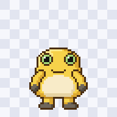<br>
      Laugh → idle<br>
      <code>laugh</code><br>
      50%: laugh directly
    </td>
    <td align="center" valign="top" width="33%">
      <b>Completed · bonus</b><br>
      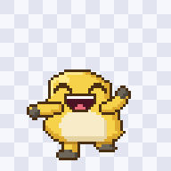<br>
      Dance → laugh → idle<br>
      <code>dance → laugh</code><br>
      50%: dance first
    </td>
    <td align="center" valign="top" width="33%">
      <b>Thinking</b><br>
      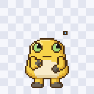<br>
      Rest a paw under the chin<br>
      <code>thinking</code><br>
      Waiting for the model, reasoning or retrying
    </td>
  </tr>
  <tr>
    <td align="center" valign="top" width="33%">
      <b>Working · 1 conversation</b><br>
      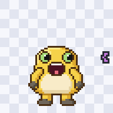<br>
      Eat code<br>
      <code>eat-code</code><br>
      1 running conversation
    </td>
    <td align="center" valign="top" width="33%">
      <b>Working · 2 conversations</b><br>
      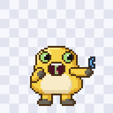<br>
      Eat faster<br>
      <code>eat-code-fast</code><br>
      2 running conversations
    </td>
    <td align="center" valign="top" width="33%">
      <b>Working · 3+ conversations</b><br>
      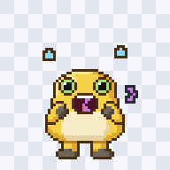<br>
      Feast<br>
      <code>feast</code><br>
      3 or more running conversations
    </td>
  </tr>
  <tr>
    <td align="center" valign="top" width="33%">
      <b>Subagent · 1</b><br>
      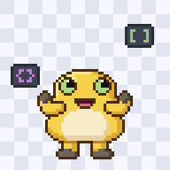<br>
      Juggle two code blocks<br>
      <code>juggle</code><br>
      1 running subagent
    </td>
    <td align="center" valign="top" width="33%">
      <b>Subagents · 2+</b><br>
      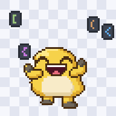<br>
      Juggle four code blocks<br>
      <code>juggle-many</code><br>
      2 or more running subagents
    </td>
    <td align="center" valign="top" width="33%">
      <b>Confirmation / answer needed</b><br>
      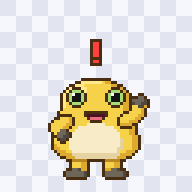<br>
      Wave for attention<br>
      <code>alert</code><br>
      Until the pending item is handled
    </td>
  </tr>
  <tr>
    <td align="center" valign="top" width="33%">
      <b>Error</b><br>
      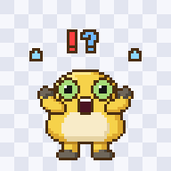<br>
      Startle with raised paws<br>
      <code>shocked</code><br>
      A task fails
    </td>
    <td align="center" valign="top" width="33%">
      <b>Context compaction</b><br>
      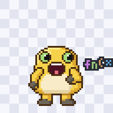<br>
      Devour a ribbon of code<br>
      <code>devour</code><br>
      While compacting
    </td>
    <td align="center" valign="top" width="33%">
      <b>Importing</b><br>
      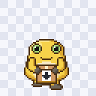<br>
      Carry a parcel<br>
      <code>carrying</code><br>
      While importing a pet pack
    </td>
  </tr>
  <tr>
    <td align="center" valign="top" width="33%">
      <b>Idle</b><br>
      <br>
      Breathe and blink<br>
      <code>idle</code><br>
      No task or temporary reaction
    </td>
    <td align="center" valign="top" width="33%">
      <b>Sleeping</b><br>
      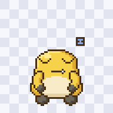<br>
      Doze while sitting<br>
      <code>sleep</code><br>
      No task and no interaction for 60 seconds
    </td>
    <td align="center" valign="top" width="33%">
      <b>Waking</b><br>
      <br>
      Wake and stretch<br>
      <code>wake</code><br>
      Woken by touch or a task
    </td>
  </tr>
</table>

### Idle variations

While awake and idle, wait 10–25 seconds and choose one of these four equally. They do not delay the 60-second sleep timer.

<table>
  <tr>
    <td align="center" valign="top" width="25%">
      <b>Idle · looking around</b><br>
      <br>
      Look around<br>
      <code>idle-look</code><br>
      2 loops per selection
    </td>
    <td align="center" valign="top" width="25%">
      <b>Idle · giggling</b><br>
      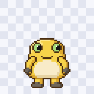<br>
      Giggle behind a paw<br>
      <code>idle-giggle</code><br>
      2 loops per selection
    </td>
    <td align="center" valign="top" width="25%">
      <b>Idle · snacking</b><br>
      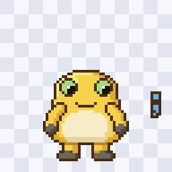<br>
      Snack<br>
      <code>snack</code><br>
      1 pass per selection
    </td>
    <td align="center" valign="top" width="25%">
      <b>Idle · dancing</b><br>
      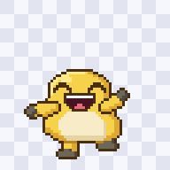<br>
      Sway and dance<br>
      <code>dance</code><br>
      2 loops per selection
    </td>
  </tr>
</table>

### Interactions and roaming

The outside-app overlay does not trigger roaming, triple taps or six-tap reactions.

<table>
  <tr>
    <td align="center" valign="top" width="33%">
      <b>Tap left</b><br>
      <br>
      Lean right and spring back<br>
      <code>poke-left</code><br>
      Tap the left half of the body
    </td>
    <td align="center" valign="top" width="33%">
      <b>Tap right</b><br>
      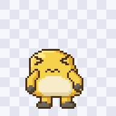<br>
      Lean left and spring back<br>
      <code>poke-right</code><br>
      Tap the right half of the body
    </td>
    <td align="center" valign="top" width="33%">
      <b>Three quick taps</b><br>
      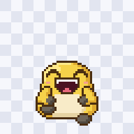<br>
      Roll laughing → stand up<br>
      <code>laugh-roll</code><br>
      3 taps within 1.1 seconds
    </td>
  </tr>
  <tr>
    <td align="center" valign="top" width="33%">
      <b>Six quick taps</b><br>
      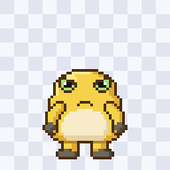<br>
      Puff and stamp → relax<br>
      <code>annoyed</code><br>
      The sixth tap resets the count
    </td>
    <td align="center" valign="top" width="33%">
      <b>Dragging</b><br>
      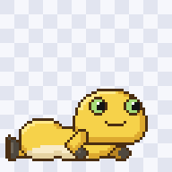<br>
      Crawl<br>
      <code>prone</code><br>
      Alternate paws and hind feet until released
    </td>
    <td align="center" valign="top" width="33%">
      <b>Idle roaming</b><br>
      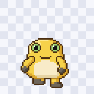<br>
      Alternate steps<br>
      <code>walk</code><br>
      Roaming while idle on the chat page
    </td>
  </tr>
</table>

## Import

Save the generated `pixel-naiwa.zip` to your phone, choose it under **Settings → Pets → Import**, then select Pixel Naiwa. Importing the same pack ID again updates the existing pet. Build commands are below.

The code characters, laughter text and other small props are drawn into the frames. Sound resources and their provenance remain in the repository for reference. This pack is designed for silent playback; audio is not bundled in the pet ZIP or APK.

## Triggers

- **Idle:** breathing and blinking play when no task or temporary reaction is active. While awake and idle, the pet waits 10–25 seconds before choosing equally between looking around, giggling, snacking and dancing, for 2, 2, 1 and 2 loops respectively. With no active task, 60 seconds without interaction leads to sleep; idle actions do not delay it. All four are not guaranteed to appear before the pet falls asleep.
- **Tasks:** the pet rests a paw under its chin while waiting for the model, reasoning or retrying. Working has three tiers based on running conversations; juggling has two tiers based on subagents. It waves when confirmation or an answer is needed, and devours a ribbon of code during context compaction.
- **Import:** while a pet pack is being imported, the pet holds a small parcel and alternates steps. It returns to the current state when importing ends.
- **Completion:** the reaction starts when a turn has ended and no new round starts for 1.5 seconds. It plays the laugh animation, with a 50% chance to dance first.
- **Taps:** tapping either half makes the pet lean away from that side. Three taps within 1.1 seconds trigger rolling laughter; the fourth and fifth restart it. The sixth switches to puffed cheeks, paws on hips and two foot stamps, then resets the count. Both reactions play once and finish in the idle pose.
- **Dragging and roaming:** dragging plays the crawl animation; releasing returns to the current state. The pet can walk while idle on the chat page. The outside-app overlay does not trigger roaming or quick-tap reactions.

## Full frame sheet

All 251 frames are collected in one image, grouped by animation and labeled with frame indices and durations. Read each group from left to right, then top to bottom. `loop` / `once` describe the asset's repeat setting; the heading gives the duration of one full pass. Click the image to view its original size.

<details>
<summary>Show all 251 frames from the 24 animations</summary>

[](docs/assets/naiwa-frames.png)

</details>

## Making the pack

| Reference | Location |
| --- | --- |
| Pack manifest and sprite sheets | [app/assets/pets/naiwa/](app/assets/pets/naiwa/) |
| Drawing notes, palette and frame catalog | [Artwork notes](app/tool/pet_src/naiwa/README.md) |
| Drawing and preview generator | [draw.py](app/tool/pet_src/naiwa/draw.py) |
| Frame durations and state mappings | [pet.json](app/tool/pet_src/naiwa/pet.json) |
| Animation design and trigger mappings | [Pixel Naiwa design](docs/design/naiwa-pet.md) |
| DSH Go pet pack format | [Pet design and format](docs/design/pets.md) |
| Retained sound resources and provenance | [Sound notes](app/tool/pet_src/naiwa/audio/README.md) |

The front-facing idle pose sets the proportions, arm lengths and paw sizes for every action. In `carrying`, both paws grip a parcel while the feet alternate steps. In `annoyed`, the pet puffs its cheeks, puts its paws on its hips, stamps and relaxes. The `prone` crawl alternates forepaw reaches and hind-foot pushes. See the artwork notes for body, face and prop drawing rules.

<details>
<summary>Regenerate artwork, the ZIP and README previews</summary>

Run from the repository root with Python, NumPy and Pillow installed:

```bash
# Redraw all frames and generate the pack manifest and sprite sheets
python app/tool/pet_src/naiwa/draw.py
python app/tool/make_pet_pack.py --only naiwa

# Build an importable ZIP
python tooling/pets/build_pet_pack.py --src app/assets/pets/naiwa --out app/build/pet_main_compat/pixel-naiwa.zip

# Check the artwork and refresh every GIF preview and the full frame sheet
python app/tool/pet_src/naiwa/draw.py --check --preview docs/assets/naiwa-frames.png --gallery docs/assets/naiwa --completion-previews docs/assets
```

</details>

## Credits and licenses

Pixel artwork by [cxsunflower](https://github.com/cxsunflower). Naiwa is a fan creation derived from Nailong; character rights belong to their respective owners. This is an unofficial pet pack. See [ASSETS.md](ASSETS.md) and the [third-party notices](THIRD_PARTY_NOTICES.md) for asset terms and provenance.

The pet system comes from [DSH Go](https://github.com/ccch1mneyyy/dsh-Go), maintained by ccch1mneyyy. Repository code is licensed under [AGPL-3.0](LICENSE), with MIT licenses for `sdk/` and `examples/`. Third-party content follows its own notices.
