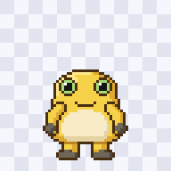
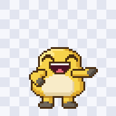
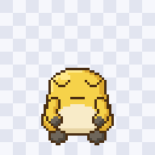
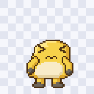

# Pixel Naiwa

[简体中文](README.md) · English

Pixel Naiwa is a silent pet pack for [DSH Go](https://github.com/ccch1mneyyy/dsh-Go), identified as `naiwa`. It keeps you company on the chat page: looking around while idle, eating code while tasks run, laughing when work finishes, and reacting to taps and drags.

Based on Naiwa, a fan creation derived from Nailong, and redrawn in pixel art. Its yellow body, cream belly, pale green eye rings and gray-brown paws share a **transparent 64×64 canvas**, with **25 animations and 254 frames** in total.

[All animation previews](#all-animation-previews) · [Import](#import) · [Triggers](#triggers) · [Full frame sheet](#full-frame-sheet) · [Making the pack](#making-the-pack)

## All animation previews

Each preview uses the original frame timing at 3× nearest-neighbor scale. All GIFs below repeat for browsing; the app controls playback through states and interactions, so single-play actions such as poking and waking still end normally. The checkerboard shows transparent areas.

<table>
  <tr>
    <td align="center" valign="top" width="33%">
      <br>
      <b>Breathe &amp; blink</b><br>
      <code>idle</code><br>
      Basic idle
    </td>
    <td align="center" valign="top" width="33%">
      <br>
      <b>Look around</b><br>
      <code>idle-look</code><br>
      Random idle
    </td>
    <td align="center" valign="top" width="33%">
      <br>
      <b>Giggle</b><br>
      <code>idle-giggle</code><br>
      Random idle
    </td>
  </tr>
  <tr>
    <td align="center" valign="top" width="33%">
      <br>
      <b>Snack</b><br>
      <code>snack</code><br>
      Random idle
    </td>
    <td align="center" valign="top" width="33%">
      <br>
      <b>Dance</b><br>
      <code>dance</code><br>
      Random idle / completion extra
    </td>
    <td align="center" valign="top" width="33%">
      <br>
      <b>Think</b><br>
      <code>thinking</code><br>
      Waiting for the model, reasoning or retrying
    </td>
  </tr>
  <tr>
    <td align="center" valign="top" width="33%">
      <br>
      <b>Eat code</b><br>
      <code>eat-code</code><br>
      1 running conversation
    </td>
    <td align="center" valign="top" width="33%">
      <br>
      <b>Eat faster</b><br>
      <code>eat-code-fast</code><br>
      2 running conversations
    </td>
    <td align="center" valign="top" width="33%">
      <br>
      <b>Feast</b><br>
      <code>feast</code><br>
      3 or more running conversations
    </td>
  </tr>
  <tr>
    <td align="center" valign="top" width="33%">
      <br>
      <b>Juggle two blocks</b><br>
      <code>juggle</code><br>
      1 subagent / importing a pack
    </td>
    <td align="center" valign="top" width="33%">
      <br>
      <b>Juggle four blocks</b><br>
      <code>juggle-many</code><br>
      2 or more subagents
    </td>
    <td align="center" valign="top" width="33%">
      <br>
      <b>Startle</b><br>
      <code>shocked</code><br>
      Error / six quick taps
    </td>
  </tr>
  <tr>
    <td align="center" valign="top" width="33%">
      <br>
      <b>Laugh</b><br>
      <code>laugh</code><br>
      Task complete
    </td>
    <td align="center" valign="top" width="33%">
      <br>
      <b>Point &amp; laugh</b><br>
      <code>laugh-point</code><br>
      Completion extra
    </td>
    <td align="center" valign="top" width="33%">
      <br>
      <b>Roll laughing</b><br>
      <code>laugh-roll</code><br>
      Random triple-tap reaction
    </td>
  </tr>
  <tr>
    <td align="center" valign="top" width="33%">
      <br>
      <b>Belly laugh</b><br>
      <code>laugh-belly</code><br>
      Random triple-tap reaction
    </td>
    <td align="center" valign="top" width="33%">
      <br>
      <b>Wave</b><br>
      <code>alert</code><br>
      Waiting for confirmation or an answer
    </td>
    <td align="center" valign="top" width="33%">
      <br>
      <b>Devour code</b><br>
      <code>devour</code><br>
      Context compaction
    </td>
  </tr>
  <tr>
    <td align="center" valign="top" width="33%">
      <br>
      <b>Doze</b><br>
      <code>sleep</code><br>
      No active task or interaction for 60 seconds
    </td>
    <td align="center" valign="top" width="33%">
      <br>
      <b>Wake &amp; stretch</b><br>
      <code>wake</code><br>
      Woken by touch or a task
    </td>
    <td align="center" valign="top" width="33%">
      <br>
      <b>Walk</b><br>
      <code>walk</code><br>
      Idle roaming on the chat page
    </td>
  </tr>
  <tr>
    <td align="center" valign="top" width="33%">
      <br>
      <b>Poke left</b><br>
      <code>poke-left</code><br>
      Tap the left half; lean right
    </td>
    <td align="center" valign="top" width="33%">
      <br>
      <b>Poke right</b><br>
      <code>poke-right</code><br>
      Tap the right half; lean left
    </td>
    <td align="center" valign="top" width="33%">
      <br>
      <b>Tickle</b><br>
      <code>tickle</code><br>
      Random triple-tap reaction
    </td>
  </tr>
  <tr>
    <td align="center" valign="top" width="33%">
      <br>
      <b>Crawl</b><br>
      <code>prone</code><br>
      Drag the pet
    </td>
    <td></td>
    <td></td>
  </tr>
</table>

## Import

Save the generated `naiwa.zip` to your phone, choose it under **Settings → Pets → Import**, then select Pixel Naiwa. Importing the same pack ID again updates the existing pet. Build commands are below.

The code characters, laughter text and other small props are drawn into the frames. Sound resources and their provenance remain in the repository for reference. This pack is designed for silent playback; audio is not bundled in the pet ZIP or APK.

## Triggers

- **Idle:** breathing and blinking play when no task or temporary reaction is active. While awake and idle, the pet waits 10–25 seconds before choosing equally between looking around, giggling, snacking and dancing, for 2, 2, 1 and 2 loops respectively. With no active task, 60 seconds without interaction leads to sleep; idle actions do not delay it. All four are not guaranteed to appear before the pet falls asleep.
- **Tasks:** the pet rests a paw under its chin while waiting for the model, reasoning or retrying. Working has three tiers based on running conversations; juggling has two tiers based on subagents. It waves when confirmation or an answer is needed, and devours a ribbon of code during context compaction.
- **Completion:** the reaction starts when a turn has ended and no new round starts for 1.5 seconds. It plays the laugh animation, with a 50% chance to first play pointing or dancing; these two extras are equally likely.
- **Taps:** tapping either half makes the pet lean away from that side. Three taps within 1.1 seconds choose equally between tickling, belly laughter and rolling laughter. The fourth and fifth taps pick again; the sixth triggers a startle and resets the count.
- **Dragging and roaming:** dragging plays the crawl animation; releasing returns to the current state. The pet can walk while idle on the chat page. The outside-app overlay does not trigger roaming or quick-tap reactions.

## Full frame sheet

All 254 frames are collected in one image, grouped by animation and labeled with frame indices and durations. Read each group from left to right, then top to bottom. `loop` / `once` describe the asset's repeat setting; the heading gives the duration of one full pass. Click the image to view its original size.

<details>
<summary>Show all 254 frames from the 25 animations</summary>

[](docs/assets/naiwa-frames.png)

</details>

## Making the pack

| Reference | Location |
| --- | --- |
| Pack manifest and sprite sheets | [app/assets/pets/naiwa/](app/assets/pets/naiwa/) |
| Drawing notes, palette and frame catalog | [Artwork notes](app/tool/pet_src/naiwa/README.md) |
| Drawing and preview generator | [draw.py](app/tool/pet_src/naiwa/draw.py) |
| Frame durations and state mappings | [pet.json](app/tool/pet_src/naiwa/pet.json) |
| Animation design and trigger mappings | [Pixel Naiwa design](docs/design/naiwa-pet.md) |
| DSH Go pet pack format | [Pet design and format](docs/design/pets.md) |
| Retained sound resources and provenance | [Sound notes](app/tool/pet_src/naiwa/audio/README.md) |

The front-facing idle pose sets the proportions, arm lengths and paw sizes for every action. The `prone` crawl alternates forepaw reaches and hind-foot pushes. See the artwork notes for body, face and prop drawing rules.

<details>
<summary>Regenerate artwork, the ZIP and README previews</summary>

Run from the repository root with Python, NumPy and Pillow installed:

```bash
# Redraw all frames and generate the pack manifest and sprite sheets
python app/tool/pet_src/naiwa/draw.py
python app/tool/make_pet_pack.py --only naiwa

# Build an importable ZIP
python tooling/pets/build_pet_pack.py --src app/assets/pets/naiwa --out app/build/pet_main_compat/naiwa.zip

# Check the artwork and refresh every GIF preview and the full frame sheet
python app/tool/pet_src/naiwa/draw.py --check --preview docs/assets/naiwa-frames.png --gallery docs/assets/naiwa
```

</details>

## Credits and licenses

Pixel artwork by [cxsunflower](https://github.com/cxsunflower). Naiwa is a fan creation derived from Nailong; character rights belong to their respective owners. This is an unofficial pet pack. See [ASSETS.md](ASSETS.md) and the [third-party notices](THIRD_PARTY_NOTICES.md) for asset terms and provenance.

The pet system comes from [DSH Go](https://github.com/ccch1mneyyy/dsh-Go), maintained by ccch1mneyyy. Repository code is licensed under [AGPL-3.0](LICENSE), with MIT licenses for `sdk/` and `examples/`. Third-party content follows its own notices.
