# 像素奶蛙

简体中文 · [English](README.en.md)

像素奶蛙是 [DSH Go](https://github.com/ccch1mneyyy/dsh-Go) 的无声宠物包，包名为 `naiwa`。它会在你思考、工作和等待时陪在聊天页上：闲下来左右张望，忙起来吃代码，任务完成后捧腹大笑，也会对点按和拖动做出反应。

来源于奶龙民间二创「奶蛙」，以像素风格重新绘制。奶黄色身体、奶油色肚皮、浅绿眼圈和灰褐色小爪，统一绘制在 **64×64 透明画布**上，共 **25 段动画、254 帧**。

[全部动作预览](#全部动作预览) · [导入使用](#导入使用) · [触发说明](#触发说明) · [完整帧图](#完整帧图) · [制作参考](#制作参考)

## 全部动作预览

每个预览按原始帧时长播放，以 3 倍整数放大保留像素边缘。为方便浏览，下面的 GIF 都会循环；App 内按状态和交互控制播放，点按、唤醒等单次动作会正常结束。棋盘格仅用于展示透明区域。

<table>
  <tr>
    <td align="center" valign="top" width="33%">
      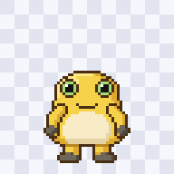<br>
      <b>呼吸眨眼</b><br>
      <code>idle</code><br>
      普通待机
    </td>
    <td align="center" valign="top" width="33%">
      <br>
      <b>左右张望</b><br>
      <code>idle-look</code><br>
      随机待机
    </td>
    <td align="center" valign="top" width="33%">
      <br>
      <b>捂嘴偷笑</b><br>
      <code>idle-giggle</code><br>
      随机待机
    </td>
  </tr>
  <tr>
    <td align="center" valign="top" width="33%">
      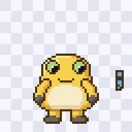<br>
      <b>吃点心</b><br>
      <code>snack</code><br>
      随机待机
    </td>
    <td align="center" valign="top" width="33%">
      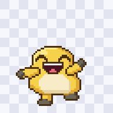<br>
      <b>摇摆跳舞</b><br>
      <code>dance</code><br>
      随机待机／完成彩蛋
    </td>
    <td align="center" valign="top" width="33%">
      <br>
      <b>托腮思考</b><br>
      <code>thinking</code><br>
      等模型、推理或重试
    </td>
  </tr>
  <tr>
    <td align="center" valign="top" width="33%">
      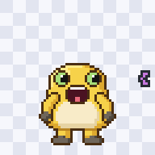<br>
      <b>吃代码</b><br>
      <code>eat-code</code><br>
      1 个运行中的会话
    </td>
    <td align="center" valign="top" width="33%">
      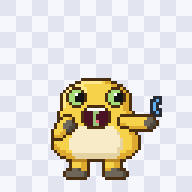<br>
      <b>加速进食</b><br>
      <code>eat-code-fast</code><br>
      2 个运行中的会话
    </td>
    <td align="center" valign="top" width="33%">
      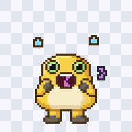<br>
      <b>狼吞虎咽</b><br>
      <code>feast</code><br>
      3 个及以上运行中的会话
    </td>
  </tr>
  <tr>
    <td align="center" valign="top" width="33%">
      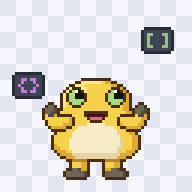<br>
      <b>抛接代码块</b><br>
      <code>juggle</code><br>
      1 个子代理／导入宠物包
    </td>
    <td align="center" valign="top" width="33%">
      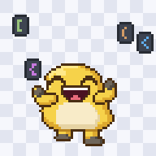<br>
      <b>多块抛接</b><br>
      <code>juggle-many</code><br>
      2 个及以上子代理
    </td>
    <td align="center" valign="top" width="33%">
      <br>
      <b>抬爪惊跳</b><br>
      <code>shocked</code><br>
      出错／六连点
    </td>
  </tr>
  <tr>
    <td align="center" valign="top" width="33%">
      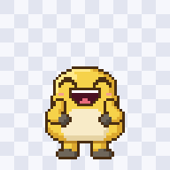<br>
      <b>捧腹大笑</b><br>
      <code>laugh</code><br>
      任务完成
    </td>
    <td align="center" valign="top" width="33%">
      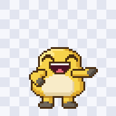<br>
      <b>指着笑</b><br>
      <code>laugh-point</code><br>
      完成彩蛋
    </td>
    <td align="center" valign="top" width="33%">
      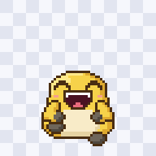<br>
      <b>翻滚笑</b><br>
      <code>laugh-roll</code><br>
      三连点随机反应
    </td>
  </tr>
  <tr>
    <td align="center" valign="top" width="33%">
      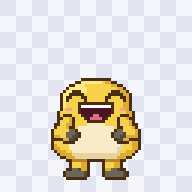<br>
      <b>肚皮起伏笑</b><br>
      <code>laugh-belly</code><br>
      三连点随机反应
    </td>
    <td align="center" valign="top" width="33%">
      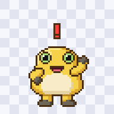<br>
      <b>挥手提醒</b><br>
      <code>alert</code><br>
      待确认／待回答
    </td>
    <td align="center" valign="top" width="33%">
      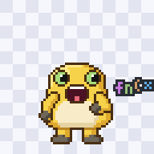<br>
      <b>吞下代码条</b><br>
      <code>devour</code><br>
      上下文压缩
    </td>
  </tr>
  <tr>
    <td align="center" valign="top" width="33%">
      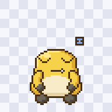<br>
      <b>坐着打盹</b><br>
      <code>sleep</code><br>
      无任务且 60 秒无交互
    </td>
    <td align="center" valign="top" width="33%">
      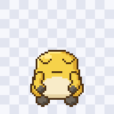<br>
      <b>醒来伸懒腰</b><br>
      <code>wake</code><br>
      触摸／任务唤醒
    </td>
    <td align="center" valign="top" width="33%">
      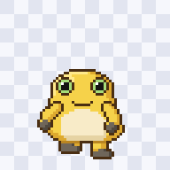<br>
      <b>走路</b><br>
      <code>walk</code><br>
      聊天页待机游走
    </td>
  </tr>
  <tr>
    <td align="center" valign="top" width="33%">
      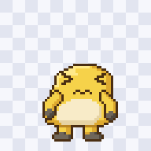<br>
      <b>左边被戳</b><br>
      <code>poke-left</code><br>
      点身体左半边，向右歪
    </td>
    <td align="center" valign="top" width="33%">
      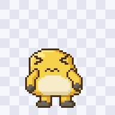<br>
      <b>右边被戳</b><br>
      <code>poke-right</code><br>
      点身体右半边，向左歪
    </td>
    <td align="center" valign="top" width="33%">
      <br>
      <b>挠痒大笑</b><br>
      <code>tickle</code><br>
      三连点随机反应
    </td>
  </tr>
  <tr>
    <td align="center" valign="top" width="33%">
      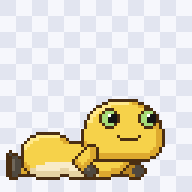<br>
      <b>趴行</b><br>
      <code>prone</code><br>
      拖动宠物
    </td>
    <td></td>
    <td></td>
  </tr>
</table>

## 导入使用

将生成的 `naiwa.zip` 保存到手机，在 **设置 → 宠物 → 导入** 中选择它，再选中「像素奶蛙」。再次导入相同包 ID 会更新已有宠物；ZIP 制作命令见下方。

吃代码时的字符、笑声文字和其他小道具均画在动画帧内。声音资源与来源记录保留在仓库中供参考，此宠物包按无声方式设计，不随宠物 ZIP 或 APK 打包音频。

## 触发说明

- **待机**：没有任务或临时反应时播放呼吸眨眼。清醒待机期间，每次等待 10–25 秒后等概率插播张望、偷笑、吃点心或跳舞，分别播放 2、2、1、2 遍。无任务且 60 秒没有交互后打盹，待机小动作不会延后睡眠；一次清醒期间不保证四种动作全部出现。
- **任务状态**：等待模型、推理或重试时托腮思考；工作动画按运行中的会话数分为三档，抛接动画按子代理数分为两档。等待确认或回答时挥手，上下文压缩时吞下代码条。
- **完成**：一轮结束后 1.5 秒内没有新一轮开始，才触发完成反应。通常播放大笑，有 50% 概率先插播指着笑或跳舞，两种彩蛋等概率。
- **点按**：左右单击分别向另一侧歪身。1.1 秒内连点三次，等概率触发挠痒大笑、肚皮起伏笑或翻滚笑；第 4、5 下继续随机触发，第 6 下变为惊跳并重新计数。
- **拖动与游走**：拖动时趴行，放手后回到当前状态；聊天页待机时可以走动。App 外悬浮窗不触发游走或连点反应。

## 完整帧图

全部 254 帧集中在一张大图中，按动作分组并标注帧编号、时长。组内从左到右、从上到下阅读；`loop` / `once` 表示素材的循环设置，标题时长为整段播放一遍的时长。点击图片可查看原始尺寸。

<details>
<summary>展开 25 段动画的全部 254 帧</summary>

[](docs/assets/naiwa-frames.png)

</details>

## 制作参考

| 内容 | 位置 |
| --- | --- |
| 宠物包清单与图集 | [app/assets/pets/naiwa/](app/assets/pets/naiwa/) |
| 绘制说明、调色板与逐帧清单 | [素材说明](app/tool/pet_src/naiwa/README.md) |
| 绘制与预览生成脚本 | [draw.py](app/tool/pet_src/naiwa/draw.py) |
| 帧时长与状态映射 | [pet.json](app/tool/pet_src/naiwa/pet.json) |
| 动作设计与触发映射 | [像素奶蛙设计](docs/design/naiwa-pet.md) |
| DSH Go 宠物包格式 | [宠物设计与格式](docs/design/pets.md) |
| 保留的声音资源与来源 | [声音说明](app/tool/pet_src/naiwa/audio/README.md) |

动作以正视待机姿势为比例基准，手臂长度和爪子尺寸保持一致。趴行动画为交替伸爪、蹬腿的 `prone`；身体、五官与道具的绘制规则见素材说明。

<details>
<summary>重新生成素材、ZIP 和 README 预览</summary>

在仓库根目录运行，需要 Python、NumPy 和 Pillow：

```bash
# 重画全部帧并生成宠物包清单与图集
python app/tool/pet_src/naiwa/draw.py
python app/tool/make_pet_pack.py --only naiwa

# 生成可导入的 ZIP
python tooling/pets/build_pet_pack.py --src app/assets/pets/naiwa --out app/build/pet_main_compat/naiwa.zip

# 校验素材并更新全部 GIF 预览与完整帧图
python app/tool/pet_src/naiwa/draw.py --check --preview docs/assets/naiwa-frames.png --gallery docs/assets/naiwa
```

</details>

## 来源与许可

像素绘制：[cxsunflower](https://github.com/cxsunflower)。角色来源为奶龙民间二创「奶蛙」，角色形象权利归相应权利人，本宠物包非官方作品。素材使用与来源说明见 [ASSETS.md](ASSETS.md) 和 [第三方声明](THIRD_PARTY_NOTICES.md)。

宠物系统来自 ccch1mneyyy 维护的 [DSH Go](https://github.com/ccch1mneyyy/dsh-Go)。仓库代码采用 [AGPL-3.0](LICENSE)，`sdk/` 和 `examples/` 采用 MIT；第三方内容按各自声明授权。
