# 像素奶蛙

简体中文 · [English](README.en.md)

像素奶蛙是 [DSH Go](https://github.com/ccch1mneyyy/dsh-Go) 的无声宠物包，包名为 `naiwa`。它会在你思考、工作和等待时陪在聊天页上：闲下来左右张望，忙起来敲键盘，任务完成后轻跃庆祝、亮起 ✅，也会对点按和拖动做出反应。

来源于奶龙民间二创「奶蛙」，以像素风格重新绘制。奶黄色身体、奶油色肚皮、浅绿眼圈和灰褐色小爪，统一绘制在 **64×64 透明画布**上，共 **24 段动画、861 帧**。

[按状态预览](#按状态预览) · [导入使用](#导入使用) · [触发说明](#触发说明) · [完整帧图](#完整帧图) · [制作参考](#制作参考)

## 按状态预览

每张卡片先写触发状态，再展示它对应的动作。任务完成时做出无声“啦”的口型，轻跃并亮起 ✅；整段播放一遍，共 2.08 秒，没有新任务时回到待机。预览从进入完成态开始，不包含前面的 1.5 秒完成判定等待。

GIF 按原始帧时长播放，以 3 倍整数放大保留像素边缘。为方便浏览，预览会重复；App 内单次反应会正常结束，任务状态随实际任务切换。棋盘格仅展示透明区域。

### 任务状态

<table>
  <tr>
    <td align="center" valign="top" width="33%">
      <b>完成</b><br>
      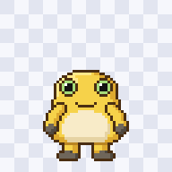<br>
      轻跃、“啦”口型与 ✅ → 待机<br>
      <code>celebrate</code><br>
      每次一遍，2.08 秒
    </td>
    <td align="center" valign="top" width="33%">
      <b>思考</b><br>
      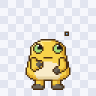<br>
      托腮思考<br>
      <code>thinking</code><br>
      等待模型、推理或重试
    </td>
    <td align="center" valign="top" width="33%">
      <b>待机</b><br>
      <br>
      脚底落地，轻呼吸眨眼<br>
      <code>idle</code><br>
      没有任务或临时反应
    </td>
  </tr>
  <tr>
    <td align="center" valign="top" width="33%">
      <b>工作 · 1 个会话</b><br>
      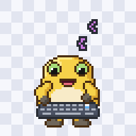<br>
      单爪敲键盘<br>
      <code>typing</code><br>
      1 个运行中的会话
    </td>
    <td align="center" valign="top" width="33%">
      <b>工作 · 2 个会话</b><br>
      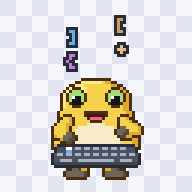<br>
      双爪交替敲键<br>
      <code>typing-both</code><br>
      2 个运行中的会话
    </td>
    <td align="center" valign="top" width="33%">
      <b>工作 · 3 个及以上会话</b><br>
      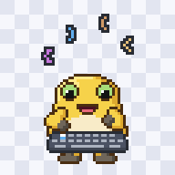<br>
      快速打字<br>
      <code>typing-fast</code><br>
      3 个及以上运行中的会话
    </td>
  </tr>
  <tr>
    <td align="center" valign="top" width="33%">
      <b>子代理 · 1 个</b><br>
      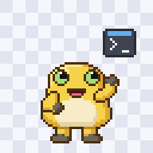<br>
      指挥一个终端<br>
      <code>terminal</code><br>
      1 个子代理运行
    </td>
    <td align="center" valign="top" width="33%">
      <b>子代理 · 2 个及以上</b><br>
      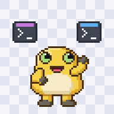<br>
      左右调度终端<br>
      <code>terminals</code><br>
      2 个及以上子代理运行
    </td>
    <td align="center" valign="top" width="33%">
      <b>待确认 / 待回答</b><br>
      <br>
      挥手提醒<br>
      <code>alert</code><br>
      持续到事项处理完成
    </td>
  </tr>
  <tr>
    <td align="center" valign="top" width="33%">
      <b>出错</b><br>
      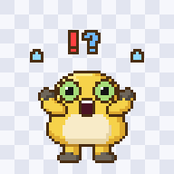<br>
      抬爪惊跳<br>
      <code>shocked</code><br>
      任务失败
    </td>
    <td align="center" valign="top" width="33%">
      <b>上下文压缩</b><br>
      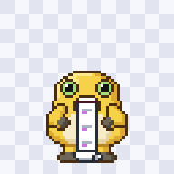<br>
      持续吃纸、双爪交替送纸<br>
      <code>eat-paper</code><br>
      压缩期间
    </td>
    <td align="center" valign="top" width="33%">
      <b>导入</b><br>
      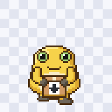<br>
      抱箱搬运<br>
      <code>carrying</code><br>
      导入宠物包期间
    </td>
  </tr>
  <tr>
    <td align="center" valign="top" width="33%">
      <b>睡眠</b><br>
      <br>
      坐着打盹<br>
      <code>sleep</code><br>
      无任务且 60 秒无交互
    </td>
    <td align="center" valign="top" width="33%">
      <b>唤醒</b><br>
      <br>
      醒来伸懒腰<br>
      <code>wake</code><br>
      触摸或任务唤醒
    </td>
  </tr>
</table>

### 待机小动作

清醒待机时，每次等待 10–25 秒后等概率选一项；这些小动作不延后 60 秒休眠计时。

<table>
  <tr>
    <td align="center" valign="top" width="25%">
      <b>待机 · 张望</b><br>
      <br>
      左右张望<br>
      <code>idle-look</code><br>
      每次 2 遍
    </td>
    <td align="center" valign="top" width="25%">
      <b>待机 · 偷笑</b><br>
      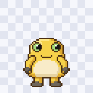<br>
      捂嘴偷笑<br>
      <code>idle-giggle</code><br>
      每次 2 遍
    </td>
    <td align="center" valign="top" width="25%">
      <b>待机 · 点心</b><br>
      <br>
      吃点心<br>
      <code>snack</code><br>
      每次 1 遍
    </td>
    <td align="center" valign="top" width="25%">
      <b>待机 · 跳舞</b><br>
      <br>
      摇摆跳舞<br>
      <code>dance</code><br>
      每次 2 遍
    </td>
  </tr>
</table>

### 交互与游走

App 外悬浮窗不触发游走、三连点和六连点。

<table>
  <tr>
    <td align="center" valign="top" width="33%">
      <b>左侧点按</b><br>
      <br>
      向右歪身再弹回<br>
      <code>poke-left</code><br>
      点身体左半边
    </td>
    <td align="center" valign="top" width="33%">
      <b>右侧点按</b><br>
      <br>
      向左歪身再弹回<br>
      <code>poke-right</code><br>
      点身体右半边
    </td>
    <td align="center" valign="top" width="33%">
      <b>三连点</b><br>
      <br>
      捧腹大笑 → 打滚 → 起身<br>
      <code>laugh-roll</code><br>
      1.1 秒内三连点；捧腹 1.44 秒，全段 2.94 秒
    </td>
  </tr>
  <tr>
    <td align="center" valign="top" width="33%">
      <b>六连点</b><br>
      <br>
      鼓腮跺脚 → 放松<br>
      <code>annoyed</code><br>
      第 6 下触发并重置计数
    </td>
    <td align="center" valign="top" width="33%">
      <b>拖动</b><br>
      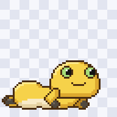<br>
      趴行<br>
      <code>crawl</code><br>
      交替伸爪、蹬腿，直到松手
    </td>
    <td align="center" valign="top" width="33%">
      <b>待机游走</b><br>
      <br>
      左右迈步<br>
      <code>walk</code><br>
      聊天页待机游走
    </td>
  </tr>
</table>

## 导入使用

将生成的 `pixel-naiwa.zip` 保存到手机，在 **设置 → 宠物 → 导入** 中选择它，再选中「像素奶蛙」。再次导入相同包 ID 会更新已有宠物；ZIP 制作命令见下方。

单爪敲键盘时的字符、笑声文字和其他小道具均画在动画帧内。声音资源与来源记录保留在仓库中供参考，此宠物包按无声方式设计，不随宠物 ZIP 或 APK 打包音频。

## 触发说明

- **待机**：没有任务或临时反应时播放呼吸眨眼。清醒待机期间，每次等待 10–25 秒后等概率插播张望、偷笑、吃点心或跳舞，分别播放 2、2、1、2 遍。无任务且 60 秒没有交互后打盹，待机小动作不会延后睡眠；一次清醒期间不保证四种动作全部出现。
- **任务状态**：等待模型、推理或重试时托腮思考；工作按运行中的会话数分为单爪敲键、双爪交替、快速打字三档，子代理按数量指挥一个或两个终端图标。等待确认或回答时挥手，上下文压缩时持续吃纸、双爪交替送纸。
- **导入**：导入宠物包期间抱着小箱子交替迈步，导入结束后回到当前状态。
- **完成**：一轮结束后 1.5 秒内没有新一轮开始，才触发完成反应。每次播放一遍轻跃庆祝：张口“啦”→收口微笑，配合绿色 ✅，共 2.08 秒，再回到当前状态。
- **点按**：左右单击分别向另一侧歪身。1.1 秒内连点三次依次捧腹大笑、打滚并起身，共 2.94 秒，其中捧腹阶段为 1.44 秒；第 4、5 下重新播放，第 6 下改为鼓腮叉腰、跺脚两次并重新计数。两种反应都只播一遍，最后恢复待机姿势。
- **拖动与游走**：拖动时趴行，放手后回到当前状态；聊天页待机时可以走动。App 外悬浮窗不触发游走或连点反应。

## 完整帧图

全部 861 帧集中在一张大图中，按动作分组并标注帧编号、时长。组内从左到右、从上到下阅读；`loop` / `once` 表示素材的循环设置，标题时长为整段播放一遍的时长。点击图片可查看原始尺寸。

<details>
<summary>展开 24 段动画的全部 861 帧</summary>

[](docs/assets/naiwa-frames.png)

</details>

## 制作参考

| 内容 | 位置 |
| --- | --- |
| 宠物包清单与图集 | [app/assets/pets/naiwa/](app/assets/pets/naiwa/) |
| 绘制说明、调色板与逐帧清单 | [素材说明](app/tool/pet_src/naiwa/README.md) |
| 绘制与预览生成脚本 | [draw.py](app/tool/pet_src/naiwa/draw.py) |
| 帧时长与状态映射 | [pet.json](app/tool/pet_src/naiwa/pet.json) |
| 动作设计与触发映射 | [像素奶蛙设计](docs/design/naiwa-pet.md) |
| DSH Go 宠物包格式 | [宠物设计与格式](docs/design/pets.md) |
| 保留的声音资源与来源 | [声音说明](app/tool/pet_src/naiwa/audio/README.md) |

动作以正视待机姿势为比例基准，手臂长度和爪子尺寸保持一致。`carrying` 双爪抱箱、交替迈步；`annoyed` 鼓腮叉腰、跺脚后放松；`crawl` 交替伸爪、蹬腿趴行。身体、五官与道具的绘制规则见素材说明。

<details>
<summary>重新生成素材、ZIP 和 README 预览</summary>

在仓库根目录运行，需要 Python、NumPy 和 Pillow：

```bash
# 重画全部帧并生成宠物包清单与图集
python app/tool/pet_src/naiwa/draw.py
python app/tool/make_pet_pack.py --only naiwa

# 生成可导入的 ZIP
python tooling/pets/build_pet_pack.py --src app/assets/pets/naiwa --out app/build/pet_main_compat/pixel-naiwa.zip

# 校验素材并更新全部 GIF 预览与完整帧图
python app/tool/pet_src/naiwa/draw.py --check --preview docs/assets/naiwa-frames.png --gallery docs/assets/naiwa --completion-previews docs/assets
```

</details>

## 来源与许可

像素绘制：[cxsunflower](https://github.com/cxsunflower)。角色来源为奶龙民间二创「奶蛙」，角色形象权利归相应权利人，本宠物包非官方作品。素材使用与来源说明见 [ASSETS.md](ASSETS.md) 和 [第三方声明](THIRD_PARTY_NOTICES.md)。

宠物系统来自 ccch1mneyyy 维护的 [DSH Go](https://github.com/ccch1mneyyy/dsh-Go)。仓库代码采用 [AGPL-3.0](LICENSE)，`sdk/` 和 `examples/` 采用 MIT；第三方内容按各自声明授权。
